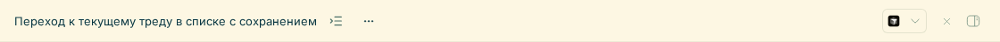

# Thread Reveal

The **Reveal thread in list** button sits immediately to the right of the open thread's title. It opens the sidebar, expands the path to the thread, scrolls its row into view, and focuses it. The row briefly receives an outline.



Keyboard shortcut: **Ctrl+Shift+L** on Windows/Linux, **⌘+Shift+L** on macOS. The action is also available in BB's command palette.

The plugin uses BB's built-in **Thread list**. It preserves grouping, sorting, group order, active/archived filters, unread grouping, and unrelated collapsed branches. Only the path to the selected thread expands. If the current filter or a hidden group excludes the thread, a message explains this and visibility settings stay unchanged.

Nested threads, multiple open panes, and the mobile sidebar are supported. Each pane's button acts on its own thread; the shortcut acts on the focused thread. The button does not appear on the New thread page.

## Installation

Requires BB **0.48.0+**, Plugin SDK **0.6.94+**, and the `thread-list/thread-list` list provider selected in Settings → Appearance → Sidebar.

```sh
bb plugin install https://github.com/artbear/bb-plugin-thread-reveal
```

The plugin leaves existing search, navigation, and thread lists in place. Releases use `vX.Y.Z` tags; the first release is `v0.1.0`.

## Keyboard shortcut

Settings → Keyboard → **Thread Reveal** → **Reveal current thread in list**.

From the BB CLI:

```sh
bb settings keyboard set plugin:thread-reveal/reveal-current-thread Mod+Shift+L
bb settings keyboard reset plugin:thread-reveal/reveal-current-thread
```

`Mod` means Command on macOS and Control on Windows/Linux. The button and shortcut invoke the same action; BB handles shortcut reassignment.

## Plugin management

```sh
bb plugin reload thread-reveal
bb plugin disable thread-reveal
bb plugin enable thread-reveal
```

Disabling the plugin removes its buttons, event handlers, DOM observer, timers, and highlighting, and cancels pending positioning.

## Development and verification

Tests require Node.js 24+.

```sh
git clone https://github.com/artbear/bb-plugin-thread-reveal.git
cd bb-plugin-thread-reveal
npm ci --include=dev
npm test
npm run typecheck
bb plugin build
bb plugin install .
```

A local path install uses that directory directly. For Git installs, BB installs dependencies and builds the plugin. The generated `dist/` directory is not committed to the repository.

Tests cover nested branch expansion, grouping by project/machine/section, inherited pinning, preservation of filters and unrelated settings, positioning in a virtualized list, multiple headers, and cleanup when disabled. Results from browser verification against a running BB instance are recorded in [docs/verification.json](docs/verification.json).

## BB integration

The command is registered through `app.commands.register`, and public SDK hooks provide its context. The official `app.contentScripts.register` API places the button beside the title. BB's standard header actions appear after the open-directory button and move into a menu on narrow screens, which does not match the required placement.

Expansion uses the public `thread-list` RPC methods `listPreferences` and `setPreference`. The plugin writes only the required `collapsed*` values. Parent threads temporarily collapsed by unread grouping are expanded using the list's native disclosure button. The plugin does not import BB's internal code.

The header and list row markup were verified against BB 0.48.0. Changes to the DOM or the Thread list contract in later versions may require a plugin update. Other list providers are not supported.
