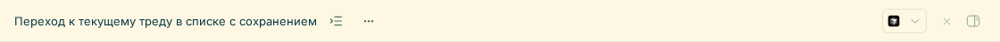

# Thread Reveal

Кнопка **«Показать тред в списке»** сразу справа от названия открытого треда. Она открывает боковую панель, раскрывает путь к треду, прокручивает список до его строки и переводит на неё фокус. Строка ненадолго получает обводку.



Горячая клавиша: **Ctrl+Shift+L** на Windows/Linux, **⌘+Shift+L** на macOS. Действие также доступно в палитре команд BB.

Плагин использует штатный **Thread list**. Сохраняются группировка, сортировка, порядок групп, фильтр активных/архивных тредов, настройка непрочитанных и свёрнутые посторонние ветки. Раскрывается только путь к выбранному треду. Если текущий фильтр или скрытая группа исключает тред, появляется сообщение; настройки видимости сохраняются.

Поддерживаются вложенные треды, несколько открытых панелей и мобильная боковая панель. Кнопка каждой панели относится к её треду; хоткей — к треду в фокусе. На странице New thread кнопки нет.

## Установка

Требуются BB **0.48.0+**, Plugin SDK **0.6.94+** и выбранный поставщик списка `thread-list/thread-list` в Settings → Appearance → Sidebar.

```sh
bb plugin install https://github.com/artbear/bb-plugin-thread-reveal
```

Плагин не заменяет существующие поиск, навигацию или список тредов. Для версий доступны теги `vX.Y.Z`; первая версия — `v0.1.0`.

## Хоткей

Settings → Keyboard → **Thread Reveal** → **Показать текущий тред в списке**.

Через CLI BB:

```sh
bb settings keyboard set plugin:thread-reveal/reveal-current-thread Mod+Shift+L
bb settings keyboard reset plugin:thread-reveal/reveal-current-thread
```

`Mod` означает Command на macOS и Control на Windows/Linux. Для кнопки и хоткея используется одно действие; переназначение обрабатывает сам BB.

## Управление

```sh
bb plugin reload thread-reveal
bb plugin disable thread-reveal
bb plugin enable thread-reveal
```

Отключение удаляет кнопку, обработчики, наблюдатель DOM, таймеры и подсветку; ожидающее позиционирование отменяется.

## Разработка и проверка

Для тестов требуется Node.js 24+.

```sh
git clone https://github.com/artbear/bb-plugin-thread-reveal.git
cd bb-plugin-thread-reveal
npm ci --include=dev
npm test
npm run typecheck
bb plugin build
bb plugin install .
```

Установка из локального каталога подключает его напрямую. При установке из Git BB самостоятельно устанавливает зависимости и собирает плагин; сгенерированный каталог `dist/` в репозитории не хранится.

Тесты проверяют раскрытие вложенных веток, группировку по проекту/машине/секциям, наследование закрепления, сохранение фильтров и посторонних настроек, позиционирование в виртуализированном списке, несколько заголовков и очистку при отключении. Результат браузерной проверки на работающем BB записан в [docs/verification.json](docs/verification.json).

## Интеграция с BB

Команда регистрируется через `app.commands.register`, контекст читается публичными хуками SDK. Официальный механизм `app.contentScripts.register` помещает кнопку рядом с названием: стандартные header actions BB размещаются после кнопки открытия рабочего каталога и на узких экранах уходят в меню, что не соответствует нужному расположению.

Для раскрытия используется публичный RPC `thread-list`: `listPreferences` и `setPreference`. Плагин записывает только необходимые значения `collapsed*`. Родительские треды, временно свёрнутые группировкой непрочитанных, раскрываются штатной кнопкой списка. Импорты внутреннего кода BB отсутствуют.

Разметка заголовка и строки списка проверена в BB 0.48.0. При изменении DOM или контракта Thread list в следующих версиях может потребоваться обновление плагина. Другие поставщики списка не поддерживаются.
